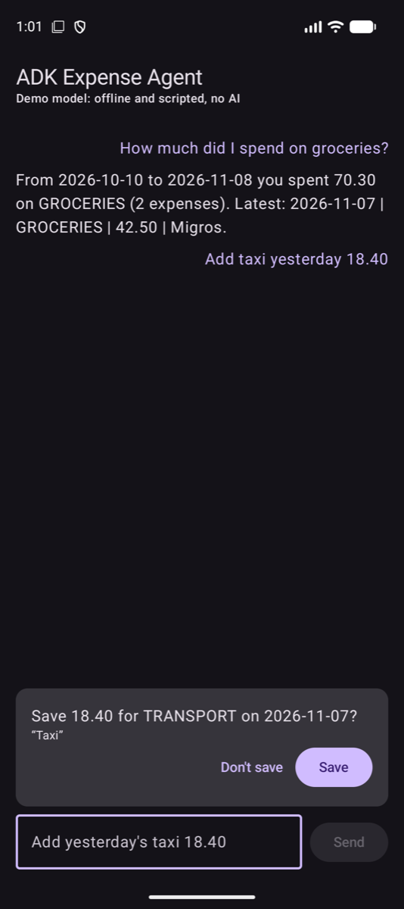

# ADK Expense Agent

[](https://github.com/omerdurmaz2/adk-expense-agent/actions/workflows/build.yml)

An Android expense assistant built with Google's **Agent Development Kit (ADK) for Kotlin**. The agent
answers questions from a Room database through typed `@Tool` functions, asks the user before every
write, keeps its conversation in Room, streams replies into Compose, and is covered by unit tests
that never call a real model.

It is the runnable companion to my article
**Build an In-App AI Agent in Kotlin with Google's ADK**
([English on Medium](#) · [Türkçe, Medium](#), links coming soon).



## Run it (no keys needed)

```bash
git clone https://github.com/omerdurmaz2/adk-expense-agent.git
cd adk-expense-agent
./gradlew installDebug
```

Or open the folder in an Android Studio version that supports AGP 9.3 and press Run.

Out of the box the app uses `DemoModel`, an offline, scripted stand-in for Gemini. It is not AI: it
picks out an amount and a few keywords and then calls the same tools a real model would. That's
enough to exercise everything else for real: the tools, the confirmation gate, the Room-backed
session and the streaming UI. The top bar always says which model is active. Try:

- `How much did I spend on groceries?` → calls `search_expenses` over the seeded data
- `Add yesterday's taxi 18.40` → calls `add_expense`, ADK pauses, the card appears, and the row is
  written only after you tap **Save**

Kill the app and open it again: the transcript comes back from `RoomSessionService`.

## What's in it

| File | What it shows |
|---|---|
| [`agent/FinanceTools.kt`](app/src/main/kotlin/dev/omerdurmaz/adkexpense/agent/FinanceTools.kt) | Two typed tools. `search_expenses` returns the total computed in Kotlin; `add_expense` has `requireConfirmation = true`, validates every argument, converts to cents with explicit rounding and never throws. |
| [`agent/FinanceAgent.kt`](app/src/main/kotlin/dev/omerdurmaz/adkexpense/agent/FinanceAgent.kt) | The `LlmAgent` and its fences: `maxSteps = 6`, `RunConfig.maxLlmCalls = 8`, a tool allowlist in `beforeToolCallbacks`, and an `onToolErrorCallback` that keeps exception text out of the prompt. |
| [`agent/FinanceRunner.kt`](app/src/main/kotlin/dev/omerdurmaz/adkexpense/agent/FinanceRunner.kt) | `createFinanceRunner`: Firebase AI Logic when configured, `DemoModel` otherwise, sessions in `RoomSessionService`. |
| [`agent/DemoModel.kt`](app/src/main/kotlin/dev/omerdurmaz/adkexpense/agent/DemoModel.kt) | The offline model behind the default run. |
| [`ui/FinanceChatViewModel.kt`](app/src/main/kotlin/dev/omerdurmaz/adkexpense/ui/FinanceChatViewModel.kt) | SSE streaming, the 60-second `withTimeout`, the confirmation round trip, transcript restore. |
| [`ui/FinanceChatScreen.kt`](app/src/main/kotlin/dev/omerdurmaz/adkexpense/ui/FinanceChatScreen.kt) | The chat and the confirmation card, built from the arguments the model actually sent. |
| [`data/Expenses.kt`](app/src/main/kotlin/dev/omerdurmaz/adkexpense/data/Expenses.kt) | `Expense`, `ExpenseRepository` and the Room implementation with a little seed data. |
| [`src/test/.../koog/AddExpenseTool.kt`](app/src/test/kotlin/dev/omerdurmaz/adkexpense/koog/AddExpenseTool.kt) | The same write tool in JetBrains Koog 1.3.0, with the confirmation written by hand. It lives in the test source set, so Koog never ships in the APK. |

The code follows the article closely. To make it a complete app, it adds `DemoModel`, the Room
repository, a generic `catch` for cloud errors in the ViewModel, and the note line on the
confirmation card.

## Tests

```bash
./gradlew testDebugUnitTest
```

Every test runs on the JVM with a `ScriptedModel` (or `DemoModel`): no network, no emulator, no keys.

- `add_expense` waits for the user, then writes 4,250 cents after approval (the test from the article)
- a rejected write never reaches the repository
- a model stuck on an invented `delete_all_expenses` tool gets "tool not available" back each time
  and stops after six model calls
- a throwing repository reaches the model only as `search_expenses failed; check the arguments`
- an invalid category (`FOOD`) shows the card first and fails after the tap
- a new ViewModel restores the transcript from the session
- `search_expenses` adds up the total in Kotlin; `add_expense` rejects future dates and rounds `HALF_UP`
- `DemoModel` drives the whole write flow and answers a question from the tool result
- the Koog tool's hand-written gate keeps rejected writes out

`testOptions.unitTests.isReturnDefaultValues = true` is set because ADK's Android logger calls
`android.util.Log`, which throws in plain JVM tests.

## Use Gemini through Firebase AI Logic (optional)

1. Create a Firebase project and add an Android app with the package `dev.omerdurmaz.adkexpense`
   (or change `applicationId` in `app/build.gradle.kts` to your own).
2. Turn on **AI Logic** with the Gemini Developer API.
3. Download `google-services.json` into `app/`. The build applies the Google services plugin only
   when that file exists, and `.gitignore` keeps it out of the repo.
4. Set up **App Check**. Firebase has enforced it for AI Logic since **November 2, 2026**, so calls
   fail without it.
   - Debug builds install the debug provider. Run the app once, copy the debug token that
     `DebugAppCheckProvider` prints to Logcat, and add it under App Check → Apps → Manage debug tokens.
   - Release builds use Play Integrity. Register your signing certificate's SHA-256 in Firebase.
5. Run the app. The top bar now reads "Gemini via Firebase AI Logic".

The model ID is `gemini-3.8-flash` in `FinanceRunner.kt`. Check Firebase's list of supported models
for the current stable ID, and don't use the `-latest` aliases. Don't put a Gemini API key in the
APK either: ADK blocks `Gemini(apiKey = ...)` on Android and points you to Firebase.

## Tested versions

| | Version |
|---|---|
| ADK for Kotlin | 1.4.0 (`core`, `processor`, `firebase-android`) |
| Koog (tests only) | 1.3.0 |
| Android Gradle Plugin | 9.3.1 |
| Gradle | 9.5.0 |
| Kotlin / KSP | 2.3.21 / 2.3.9 |
| Room | 2.8.4 (the version ADK's `RoomSessionService` uses) |
| Firebase BoM | 35.0.2 |
| Compose BOM | 2026.09.00 |
| compileSdk / minSdk | 37 / 26 (ADK 1.4.0 AARs declare `minCompileSdk` 37) |
| JDK | 21 |

`./gradlew assembleDebug testDebugUnitTest lint` passes on these versions, and the demo flow was
checked on a Pixel 9 emulator (API 36). The Firebase path compiles but isn't exercised by CI,
since CI has no `google-services.json`.

### Upgrading ADK

ADK for Kotlin **1.5.0** (2026-10-28) is out. This repo stays on 1.4.0 to match the article. If you
upgrade and also add on-device inference with `google-adk-kotlin-litertlm`, 1.5.0 needs
`com.google.ai.edge.litertlm:litertlm-android` between 0.15 and 0.18.1 (1.4.0 builds against
0.13.1). Rerun the tests after any bump. ADK still labels tool confirmation experimental.

## Things the tests pinned down

- ADK wraps whatever a tool returns as `{"result": {...}}`. Errors from callbacks and from ADK itself
  (unknown tool, bad enum value, rejected confirmation) arrive unwrapped as `{"error": ...}`.
- The confirmation gate runs before argument parsing, so a user can approve a draft that then fails
  validation. Validate in a `beforeToolCallback` if that matters to you.
- When `maxSteps` is reached, the turn ends quietly and no exception is thrown.
- After process death only the text comes back. A card that was pending isn't restored.

## Türkçe

Bu repo, **"Android Uygulamanıza AI Agent Eklemek: Google ADK for Kotlin ile Adım Adım"** yazısının
çalışan kodudur ([Medium](#), link yakında). Klonlayıp Android Studio'da açın ve Run'a basın.
Anahtar gerekmez, çünkü varsayılan model çevrimdışı çalışan `DemoModel`. Yapay zekâ değildir, ama
araçları, onay kartını, Room oturumunu ve akışlı arayüzü gerçekten çalıştırır.
"Add yesterday's taxi 18.40" yazınca kart çıkar ve kayıt ancak **Kaydet**'e bastıktan sonra
yazılır. Gerçek Gemini için `app/` altına kendi `google-services.json` dosyanızı koyun ve App
Check'i açın (2 Kasım 2026'dan beri zorunlu). Testler için `./gradlew testDebugUnitTest` yeterli,
ağ ya da emülatör istemez.

## License

[Apache License 2.0](LICENSE). This is a personal project. It isn't affiliated with or endorsed by
Google or JetBrains.
